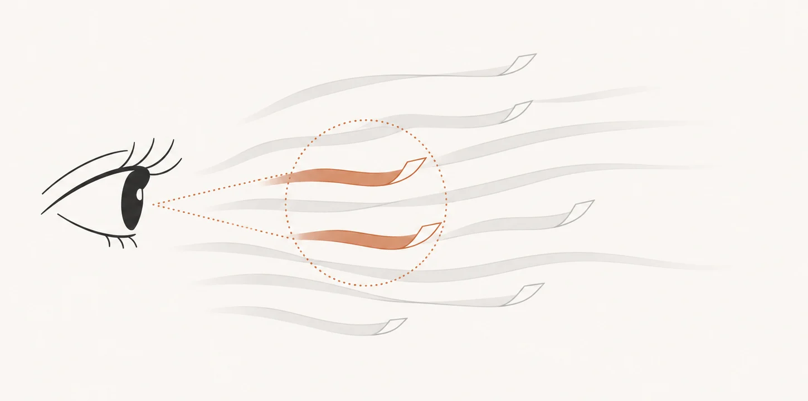
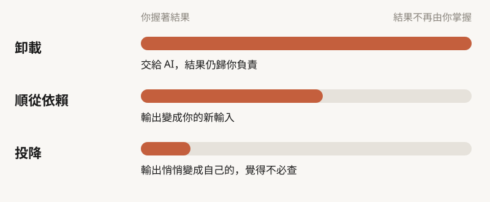
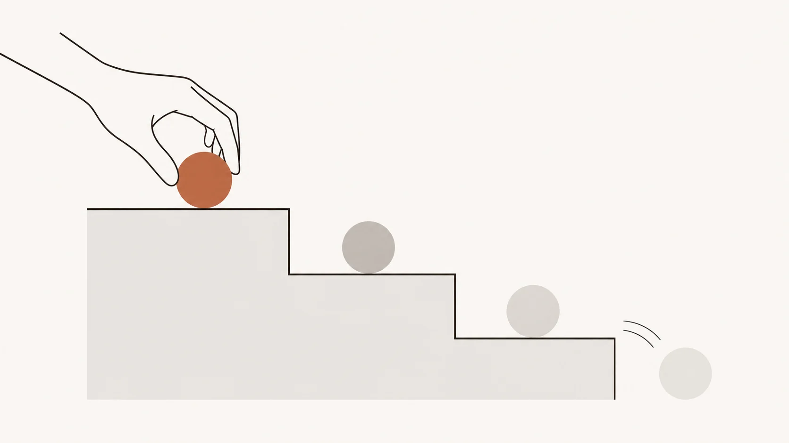
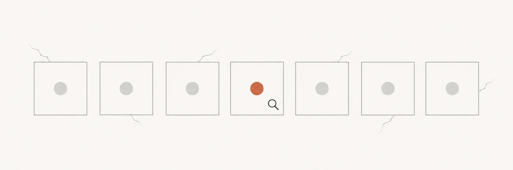
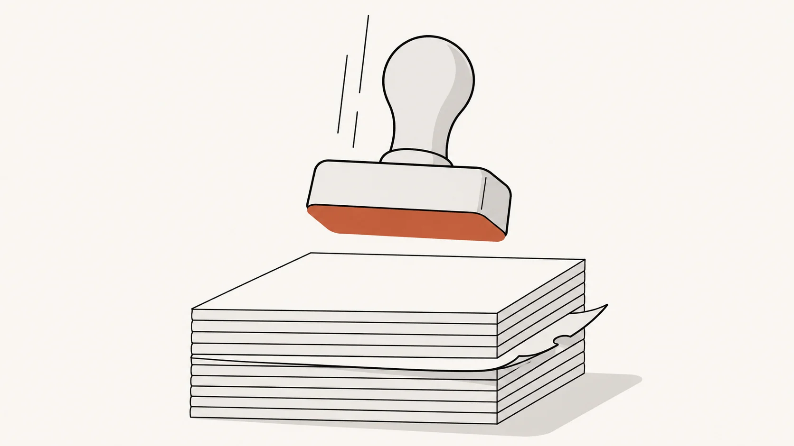
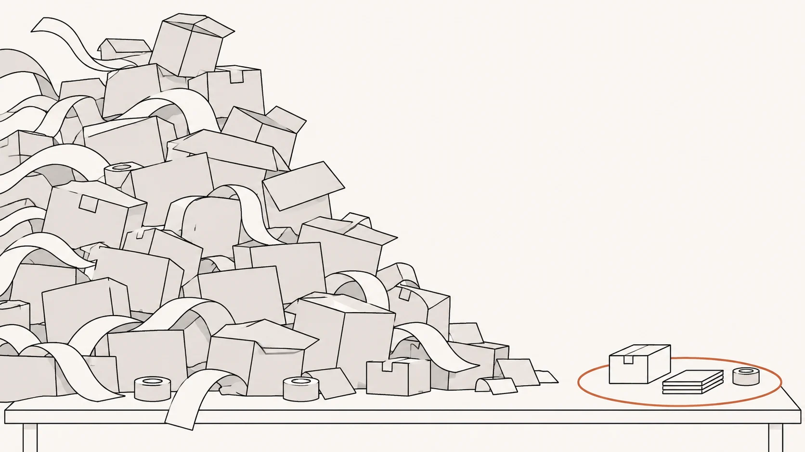

> 本導讀的分析與撰稿由 AI 模型完成，不是人類分析，也沒有經過人工逐句校稿。

*圖說：AI 生成的概念插畫，比喻人只有一雙眼睛，細看得了的只有流過的一小部分。*

## 先看重點

- Osmani 是 agent 工具的愛用者，這篇談的是**用得越順，越沒有東西逼你思考**。
- 人對 AI 輸出的態度會沿著一條光譜往下滑：先是卸載，再來順從依賴，最後投降。每一步都合理，所以很少被察覺。
- 他的對策很具體：先寫下自己的假設、先定義什麼叫「驗證完成」、先讀證據再讀摘要，並把這些檢查排進行程。

## 輸出越流暢，越沒人細看

模型變強以後，明顯的錯誤變少了。Osmani 形容多數輸出（他自己在句尾加了問號，說「也許是大多數」）寫得流暢、大致正確，沒有哪一份會逼你再看第二眼。他的觀察是，同時跑多少個 agent 都一樣，你仍然只有一雙眼睛，而且預設情況下沒有任何機制替你做批判思考。

過去，問題與答案之間隔著一段時間，認知與品味判斷大多發生在那裡；現在那段時間縮成幾秒。再加上這些工具用起來愉快，快、順、常常對，正好讓人放鬆警覺。

他回到的是一些很基本的自問：動手前有沒有先形成假設（完全沒頭緒時，可以請模型做一輪「盲點檢查」，這是 [Thariq Shihipar 的用語](https://claude.com/blog/a-field-guide-to-claude-fable-finding-your-unknowns)）、是要它幫我想還是替我想、要怎樣這個結論才會錯、有沒有請不同模型各論證反方、敢不敢在要維護它的人面前押注，以及自己有哪些事已經不再練習。

## 一條往下滑的光譜

Osmani 把人與 AI 的關係分成三階。

*圖說：本文依原文歸納的光譜，由上而下，人對結果的所有權逐步減少。*

- **卸載（cognitive offloading）**：把任務交給 AI，結果仍歸你負責。他自己整天都在做，也建議讀者這樣做。
- **順從依賴（deferral）**：工具的輸出成了你下一步的輸入，結果不再只是待檢驗的假設。
- **投降（cognitive surrender）**：AI 的輸出悄悄變成你自己的，你覺得沒必要檢查。這個詞出自 Wharton 的 Steven Shaw 與 Gideon Nave（[Wharton 訪談](https://knowledge.wharton.upenn.edu/podcast/ripple-effect/how-ai-is-reshaping-human-intuition-and-reasoning-gideon-nave-and-steven-shaw/)）。

他描述的滑落過程很日常：上一則答案讀得仔細，下一則略讀，再下一則只看骨架，直到有人問起某一行，你連請 agent 協助也解釋不出來。

*圖說：AI 生成的概念插畫，比喻每往下一階，結果就離你的手更遠一點。*

這種虧空有幾個名字。對團隊來說，是對系統的共同理解逐漸流失（[Margaret-Anne Storey](https://margaretstorey.com/blog/2026/02/09/cognitive-debt/)，2026-02）。對程式碼來說，是「理解債」：程式碼的量與真正有人懂的量之間的差距。「理解債」較早見於 Jason Gorman 2025 年 10 月的文章（[Codemanship](https://codemanship.wordpress.com/2025/10/26/the-ai-ready-software-developer-10-comprehension-debt)），Osmani 也寫過同名文章（[Osmani](https://addyosmani.com/blog/comprehension-debt/)，2026-03）。

> 註：原文把「理解債」歸給 Jeremy Twei，與可查到的出處不同，這裡以 Gorman 為準。

這類債當下完全看不見，程式庫乾淨、測試全過，要等到必須動它的那天才發現沒有人懂。

## 懂到什麼程度才夠

這裡容易誤讀成「每一行都要自己看」。Osmani 的意思剛好相反：大型程式庫的完整心智模型根本維持不了。他舉 Claude Code 團隊為例，有人想弄懂某個部分，就請 Claude 為那一小塊寫一份解說（[Anthropic 官方文章](https://claude.dev/blog/solving-code-review-at-anthropic/)，2026-10-15，Osmani 是該文共同作者；文中也說團隊沒有為此訂正式流程）。**需要時能在局部重建，並且知道自己哪裡沒有，就夠了。**

要不要交出去，看賭注。他曾請 AI 從三間評價相近的旅館裡挑一間當錄課地點，這種委派他願意再做；投資、孩子的職涯建議，以及工作上要做什麼、影響哪些使用者、能不能上線，這幾類他都自己留著。**錯了代價低，就交出去；後果要由別人承擔的，推理留在自己手上。**

## 驗證要在動手之前定義

Osmani 認為瓶頸已經從寫程式，移到確定自己是對的。給 agent 驗證的手段，例如端對端測試、屬性測試或實際操作 app，它就能改、跑、讀輸出、再改，全在你看到之前完成。他把這個方向連到 Boris Cherny 的建議：讓 Claude 有辦法檢驗自己的成果（單一來源，見[二手報導](https://www.infoq.com/news/2026/01/claude-code-creator-workflow/)）。你的工作從逐行讀，變成建這類迴圈、審證據。

這套做法自己也會滑向投降。「有證據支持我的結論嗎？」會縮成「燈綠了嗎？」agent 寫測試太便宜，綠燈很容易滿天飛；測試若帶著和功能同樣的錯，照樣會過。綠燈只證明一個性質，卻容易被當成什麼都證明了。燈一綠，問兩句：它證明了什麼？沒證明什麼？

*圖說：AI 生成的概念插畫，比喻一個綠燈只照亮了一個性質，其他地方的裂縫仍沒人看。*

他給了三個具體動作：

1. **事前定義「驗證完成」**：事後你什麼結果都能合理化。完成線要是看得見的東西，像測試通過、一張截圖、一段 log。
2. **先讀證據，再讀摘要**：agent 說做完了，先看它跑的指令與輸出。
3. **把自我批判放進迴圈**：讓一個全新 context 的子代理審查，每次都跑；收尾再問一句「我有漏掉什麼嗎？」，他說常能多挖出兩三項。

深度則看情況。他引用前述 Anthropic 文章的經驗法則：說不出檢查會漏掉什麼，就要求真正的審查，不要快速核准。這不限於程式；請 agent 彙整客戶訪談或競品分析時，也抽查幾份原始資料，核對建議所依賴的那個數字。

## 審查會滑成蓋章

審一份六百行的 PR，你看結構、命名合理、測試通過，就核准了。問題是你只審了本來就知道會找到的東西，交易邊界的順序被動過、某個邊界案例的預設值被翻轉，這類變動不在你的預期裡。

*圖說：AI 生成的概念插畫，比喻快速核准時，夾在中間那頁有問題的紙沒被看見。*

寫程式與審程式是兩種技能。Osmani 建議兩層讀法：先把 diff 當成不是 AI 寫的來讀，再往 diff 外看，agent 在長 session 裡替你做了哪些決定，包括預設值、範圍取捨、需求衝突時的詮釋。摘要不會講這些，所以要它列出決策與假設，再隨機挑幾行問自己為什麼。文件則是闔上之後，試著憑記憶寫出主要論點。他欣賞的一種做法：讓 Claude 為變更寫報告，結尾附一份測驗，全對才合併（他說這是某些人在長 session 裡的習慣）。**他的標準是懂到足以替它辯護，因為隨時可能有人來問。**

量大了也要誠實面對。他把 agent 產出的量，與自己願意署名的量之間的落差，稱為「協調稅」（[Osmani](https://addyosmani.com/blog/orchestration-tax/)，2026-05）。完成的東西堆得比消化得快，再開一個 session 沒有幫助，只能收緊檢查或放慢。他的話很直接：產出多到無法署名時，你已經不是在審查，而是在期待。

*圖說：AI 生成的概念插畫，比喻 agent 的產出量與你能署名的量之間的落差。*

agent 也能替你守住注意力。他維護的開源專案收到大量 PR，會先請 agent 分出哪些違反準則、哪些需要他親自看，但很少讓 agent 自己下判斷，思考這些變更有沒有解對問題的仍是他。

## 意圖得由人給

人的心智模型還在，只是位置從中間移到兩端：前端是任務描述，後端是審查。所以他把寫 prompt 看成批判思考的一部分，prompt 清不清楚，反映你自己懂了多少。

過去含糊的要求會被同事追問，你才發現自己沒想清楚；agent 通常不會攔你，它補上你沒說的，交回一份看起來完成的東西。Osmani 把這種缺口叫「意圖債」，這個框架來自 Storey 與同事的論文（[arXiv](https://arxiv.org/abs/2603.22106)，2026-03，與技術債、認知債並列），這筆債沒有別人能替你還。

做法很樸素：先用自己的話寫需求簡述，含對象、不在範圍內的事、完成的定義；第二輪修正還沒到位，就停下來重寫 prompt。想不清楚時，可以請 agent 反過來訪談你。收工時如果你對問題的理解比開始時更清楚，就算成功。

多個 agent 串接時，另有一個陷阱：每個只傳上一個的摘要，第三個可能從沒讀過原始文件。還有，現在輸出一律排版漂亮又有自信，光鮮不再是品質的訊號，所以他對自己的產出設了標準：不願署名的，就不放出去。不合標準的原因，他建議寫進共用設定、hook 或測試，讓品味累積下來。

## 模型會變強，問責不會移轉

讀到這裡，你可能想到：一兩年後模型能偵測到我能偵測的一切，何必維持這項技能？Osmani 部分同意，他自己也主張把更多偵測交給 agent。但最後總得有人為出貨的東西負責，不管 AI 幫了多少。

要多信任 agent，本身也是判斷題，而模型出錯的地方一直在變，所以審查不能停。他引用 Anthropic 研究自家工程師時提出的「監督悖論」：監督 Claude 需要的程式技能，可能因過度依賴 AI 而退化（[Anthropic](https://www.anthropic.com/research/how-ai-is-transforming-work-at-anthropic)，2025-12）。在他看來，做什麼、為什麼值得、影響誰、願意犧牲什麼，這些問題更好的模型也解不了。工作和大部分稽核可以交出去，問責不行。

## 把檢查排進行程

他說不必全做，挑適合自己的。每週不靠 agent 寫一小段程式，或做一件忘了會很糟的實事；每月寫下自己已經不做的事，決定哪些放掉；碰到超出理解的東西，花點時間弄懂它放在哪裡。檢查機器是真正的工作，假裝它不花時間，團隊就不會做，所以要排成工作項目。不練的技能會消失，而且可能比預期快；不想放掉的，就繼續做。

他最後留給讀者一個實驗：下次問之前，先寫下你以為會發生什麼；agent 做完後，寫下它沒檢查的一件事，看看這會不會改變你讀輸出的方式。

## 本文的判斷與限制

以下是本文的看法，不是 Osmani 的主張。

- **多數做法可以工程化。** 完成條件、證據、自我批判的子代理、把標準寫進設定檔，都能做成流程，靠流程比靠意志力可靠。原文把「意圖」與「問責」明確留給人。
- **證據的性質。** 這是一位資深實踐者的經驗與主張，文中沒有對照實驗或數據。它說的是怎樣比較穩，並沒有證明這樣做的結果比較好。
- **新手的缺口。** 原文的練習（例如每週手寫一次）預設讀者已有手感，對沒有親手寫過程式的初階工程師並不直接適用。原文頁面底下也有讀者問到類似的問題，原文未正面處理，要回答得另找資料。

## 製作說明：這篇導讀由 AI 模型完成

本導讀的研究、撰稿、審稿與插圖皆由 AI 模型完成，不是人類分析，也沒有經過人工逐句校稿。分工：主控、撰稿與網頁製作為 Claude Sonnet 5.5；外部引用的查證、兩輪審稿（事實忠實度、編輯可讀性）與網頁版面評審由 Claude Sonnet 子代理執行；導讀回譯成英文對照原文的查核與術語對照由 Gemini 3.8 Flash（agy CLI）輔助；封面與四張概念插畫由 Codex imagegen 生成（圖內無文字），光譜為程式繪製的互動元件。原文為受版權保護的作品，本文只做整理與分析、少量短句轉述，不提供全文譯文，細節請讀原文。

## 來源清單

| 來源 | 日期 | 說明 |
|---|---|---|
| [Critical thinking when agents do the work（Addy Osmani，X 長文）](https://x.com/addyosmani/status/2117512471930167377) | 2026-11-03 | 本導讀的主要來源 |
| [Wharton：How AI is reshaping human intuition and reasoning（Nave 與 Shaw）](https://knowledge.wharton.upenn.edu/podcast/ripple-effect/how-ai-is-reshaping-human-intuition-and-reasoning-gideon-nave-and-steven-shaw/) | 2026-02-24 | cognitive surrender 的出處 |
| [Margaret-Anne Storey：Cognitive Debt](https://margaretstorey.com/blog/2026/02/09/cognitive-debt/) | 2026-02-09 | 團隊共同理解流失 |
| [Storey 等：arXiv 2603.22106](https://arxiv.org/abs/2603.22106) | 2026-03-23 | 技術債、認知債、意圖債三分框架 |
| [Jason Gorman：Comprehension Debt（Codemanship）](https://codemanship.wordpress.com/2025/10/26/the-ai-ready-software-developer-10-comprehension-debt) | 2025-10-26 | 「理解債」一詞的較早出處 |
| [Addy Osmani：Comprehension Debt](https://addyosmani.com/blog/comprehension-debt/) | 2026-03-14 | 作者的相關文章 |
| [Addy Osmani：The Orchestration Tax](https://addyosmani.com/blog/orchestration-tax/) | 2026-05-24 | 協調稅 |
| [InfoQ：Claude Code 創作者的工作流程（二手報導）](https://www.infoq.com/news/2026/01/claude-code-creator-workflow/) | 2026-01-10 | Boris Cherny 的建議，未取得一手原話 |
| [Claude 官方部落格：A field guide to Claude（Thariq Shihipar）](https://claude.com/blog/a-field-guide-to-claude-fable-finding-your-unknowns) | 2026-07-06 | 盲點檢查（blind spot pass） |
| [Anthropic：How AI is transforming work at Anthropic](https://www.anthropic.com/research/how-ai-is-transforming-work-at-anthropic) | 2025-12-02 | 監督悖論 |
| [How the Claude Code team does code review（claude.dev）](https://claude.dev/blog/solving-code-review-at-anthropic/) | 2026-10-15 | 經驗法則與「為那一小塊寫解說」 |
